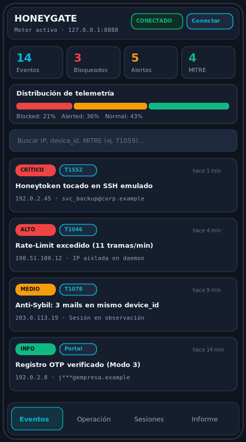
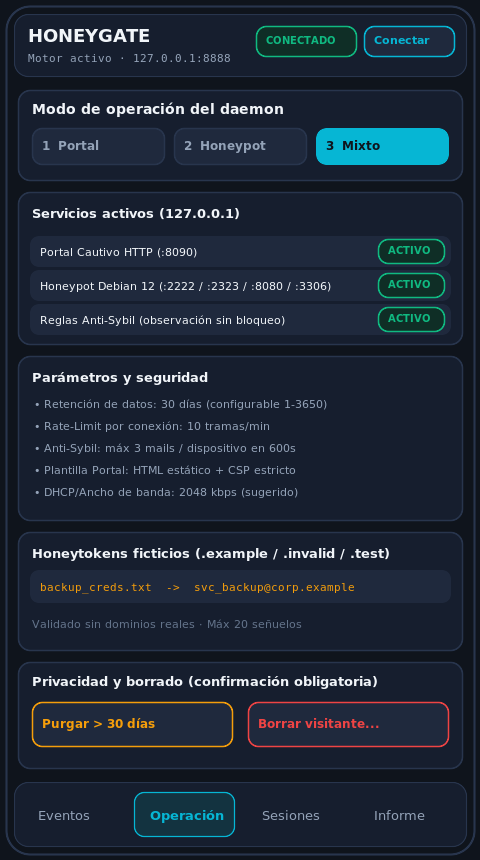
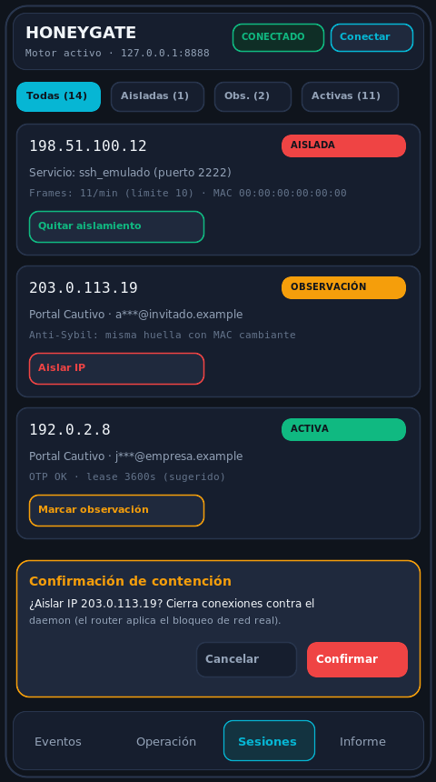
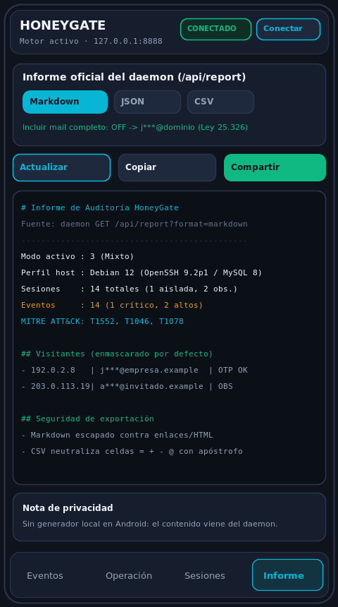
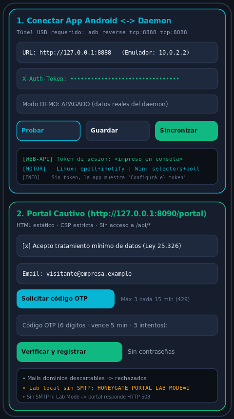

# 🛡️ HoneyGate

Framework defensivo de decepción ("puerta de miel"): une un portal cautivo con trazabilidad y un honeypot contenido, con un panel de control en Android. 😀🙌

- ⚡ **Motor (daemon):** Python 3.11+, sin `root`, multiplataforma:
  - 🐧 **Linux (Kali, Debian, Ubuntu) y WSL2:** usa `epoll`, `inotify` y auditoría `/proc/net/*` nativos.
  - 🪟 **Windows 10/11 (PowerShell nativo):** cambia automáticamente al motor portable `selectors` + monitoreo de bitácoras por *polling* (sin requerir `fcntl`, `epoll` ni `inotify`).
- 📱 **Panel:** app Android (Jetpack Compose + Room). Configura el motor y muestra su telemetría en tiempo real o desde caché local.

> ⚠️ **Uso autorizado únicamente.** Desplegar solo en redes propias o con autorización escrita del titular (Ley 26.388). Los datos de visitantes se tratan con consentimiento explícito (Ley 25.326). Ver [Marco legal](#%EF%B8%8F-marco-legal).

---

## 📑 Índice

1. [🧐 Qué hace y qué no hace](#-qué-hace-y-qué-no-hace)
2. [🗺️ Arquitectura](#%EF%B8%8F-arquitectura)
3. [⚡ Inicio rápido (Windows y Linux)](#-inicio-rápido-windows-y-linux)
4. [💻 Instalar y arrancar el daemon](#-instalar-y-arrancar-el-daemon)
5. [📦 Obtener el APK](#-obtener-el-apk)
6. [📲 Instalar el APK en el celular](#-instalar-el-apk-en-el-celular)
7. [🔗 Conectar la app con el daemon](#-conectar-la-app-con-el-daemon)
8. [🖼️ Pantallas y características de uso](#%EF%B8%8F-pantallas-y-características-de-uso)
9. [🎛️ Los tres modos](#%EF%B8%8F-los-tres-modos)
10. [🖥️ Consola del daemon](#%EF%B8%8F-consola-del-daemon)
11. [🔌 API REST](#-api-rest)
12. [⚙️ Variables de entorno](#%EF%B8%8F-variables-de-entorno)
13. [🚪 Puertos](#-puertos)
14. [🐧 Servicio systemd (Linux)](#-servicio-systemd-linux)
15. [🧪 Pruebas](#-pruebas)
16. [❓ Solución de problemas (Si falla X 👉 verificá Y)](#-solución-de-problemas-si-falla-x--verificá-y)
17. [🚧 Límites conocidos](#-límites-conocidos)
18. [⚖️ Marco legal](#%EF%B8%8F-marco-legal)
19. [🗂️ Estructura del repositorio](#%EF%B8%8F-estructura-del-repositorio)

---

## 🧐 Qué hace y qué no hace

### ✅ Qué hace

| Modo | Para qué sirve |
| --- | --- |
| **1 — Portal cautivo** | Registro con mail + código OTP (sin contraseña), consentimiento informado, huella del dispositivo y reglas anti-Sybil que marcan sesiones "en observación". |
| **2 — Honeypot** | Servicios emulados (SSH, Telnet, HTTP, MySQL) con el perfil de un único servidor **Debian 12**. Registra comandos, los mapea a MITRE ATT&CK y alerta cuando se toca un honeytoken. |
| **3 — Mixto** | Portal opcional más el panel completo del modo 2, sobre el mismo esquema de datos SQLite. |

💡 En los tres modos tenés: informe de auditoría exportable (JSON, CSV seguro contra fórmulas, Markdown escapado), borrado de datos por antigüedad o por visitante, y aislamiento de una IP con confirmación previa.

### 🚫 Qué NO hace

El daemon corre sin `root`, así que por diseño:

1. **No redirige el WiFi** ni el tráfico DNS/HTTP hacia el portal. 👉 Eso lo hace el router o el punto de acceso.
2. **No limita el ancho de banda.** `bandwidth_kbps` es un valor **sugerido**, no aplicado a la red.
3. **No corta la salida a internet de los clientes** ni administra DHCP. `dhcp_lease_sec` también es **sugerido**. "Aislar" una IP cierra las conexiones de esa IP *contra el daemon* y la anota en su tabla interna; no toca `iptables`/`nftables`.
4. **No ejecuta nada de lo que escribe un atacante.** Las respuestas de los servicios emulados salen de una tabla fija y el daemon no abre conexiones salientes ni resuelve DNS por entrada externa.

---

## 🗺️ Arquitectura

```text
 📱 Celular Android                       💻 PC (Windows PowerShell / Linux / WSL2)
 ┌──────────────────┐   adb reverse      ┌───────────────────────────────────────┐
 │  App HoneyGate   │ ─────────────────► │ 127.0.0.1:8888  API REST + panel web   │
 │  (panel M3)      │   HTTP + token     │ 127.0.0.1:8090  Portal cautivo (modo 1)│
 └──────────────────┘                    │ 127.0.0.1:2222  SSH emulado            │
                                         │ 127.0.0.1:2323  Telnet emulado         │
 🌐 Visitante / Red Team ──────────────► │ 127.0.0.1:8080  HTTP emulado           │
   (lo acerca el router o un túnel)      │ 127.0.0.1:8443  HTTP señuelo           │
                                         │ 127.0.0.1:3306  MySQL emulado          │
                                         │ data/honeygate.db  (SQLite)            │
                                         └───────────────────────────────────────┘
```

💡 El daemon es el dueño de los datos. La app no inventa telemetría: guarda en Room una copia local de lo que recibe y avisa cuando está sin conexión.

---

## ⚡ Inicio rápido (Windows y Linux)

### 🪟 En Windows (PowerShell)

```powershell
# 1. Clonar y entrar al proyecto
git clone https://github.com/AlbertiJ/HoneyGate.git
cd HoneyGate

# 2. Arrancar el motor (usa selectors + polling automático en Windows)
python run_framework.py        # anotá el token que muestra al arrancar
```

👉 Si `python` no funciona o te abre Microsoft Store, probá `py -3 run_framework.py`.

### 🐧 En Linux / WSL2

```bash
# 1. Clonar y arrancar el motor (usa epoll + inotify nativos)
git clone https://github.com/AlbertiJ/HoneyGate.git
cd HoneyGate
python3 run_framework.py       # anotá el token que muestra al arrancar
```

### 📱 Conectar el celular Android (desde Windows o Linux)

```bash
adb install app-debug.apk      # ver "Obtener el APK"
adb reverse tcp:8888 tcp:8888
```

👉 En la app tocá **Conectar** → URL: `http://127.0.0.1:8888` → pegá el token que imprimió la consola → **Probar → Guardar → Sincronizar**. 😎

---

## 💻 Instalar y arrancar el daemon

### 📋 Requisitos

- **Python 3.11 o superior** (en Windows o Linux/macOS).
- **Motor de red automático:**
  - En Linux/WSL2 usa `epoll` + `inotify` nativos.
  - En Windows (PowerShell / CMD) usa `selectors.DefaultSelector()` + *polling* de logs automático.
- El núcleo usa solo la librería estándar de Python. `requirements.txt` agrega `prompt_toolkit` (consola interactiva enriquecida) y `requests` (scripts de `modules/`).

---

### 🪟 Instalación detallada en Windows (PowerShell nativo)

⚠️ **Importante para usuarios de Windows PowerShell 5.1:**
PowerShell **no** acepta `&&` ni `source` estilo Bash. Ejecutá los comandos en **líneas separadas** 👇:

```powershell
git clone https://github.com/AlbertiJ/HoneyGate.git
cd HoneyGate

# Crear entorno virtual (opcional pero recomendado)
python -m venv .venv

# Si PowerShell bloquea scripts locales, habilitalo solo para esta ventana:
Set-ExecutionPolicy -Scope Process -ExecutionPolicy Bypass

# Activar el entorno virtual en Windows:
.venv\Scripts\Activate.ps1

# Instalar dependencias opcionales de consola y módulos
pip install -r requirements.txt

# Iniciar HoneyGate
python run_framework.py
```

💡 **Cómo pasar variables de entorno en PowerShell** (por ejemplo token fijo o modo laboratorio del portal):

```powershell
# Generar un token aleatorio seguro:
python -c "import secrets; print(secrets.token_urlsafe(32))"

# Definir variables para la sesión actual de PowerShell:
$env:HONEYGATE_API_TOKEN = "pega_aqui_tu_token_aleatorio"
$env:HONEYGATE_PORTAL_LAB_MODE = "1"
python run_framework.py
```

💡 Para modo sin consola interactiva (*headless*) en Windows:

```powershell
$env:HONEYGATE_HEADLESS = "1"
python run_framework.py
```

👉 Alternativa en Windows: también podés correrlo dentro de **WSL2** (Ubuntu/Kali) si querés `epoll`, `inotify`, `systemd` de usuario y auditoría `/proc/net/*`.

---

### 🐧 Instalación detallada en Linux / WSL2

```bash
git clone https://github.com/AlbertiJ/HoneyGate.git
cd HoneyGate
python3 -m venv .venv && source .venv/bin/activate     # opcional
pip install -r requirements.txt                        # opcional
python3 run_framework.py
```

Al arrancar, el daemon informa dónde escucha y, si no definiste un token, genera uno efímero para esa sesión:

```text
[WEB-API] HONEYGATE_API_TOKEN no definido; token generado para esta sesión: <token>
[WEB-API] Dashboard y Endpoints JSON activos en http://127.0.0.1:8888
[PORTAL-HTTP] Portal Cautivo activo en http://127.0.0.1:8090
```

Ese token cambia en cada arranque y queda escrito en `logs/honeywall.log`. Para usar un token fijo en Linux:

```bash
cp .env.example .env && chmod 600 .env
# Editá .env y completá, por ejemplo:
#   HONEYGATE_API_TOKEN=<valor largo y aleatorio>
# Generar uno:  python3 -c "import secrets; print(secrets.token_urlsafe(32))"

set -a; . ./.env; set +a      # el daemon no lee .env por sí solo
python3 run_framework.py
```

Sin consola interactiva en Linux:

```bash
HONEYGATE_HEADLESS=1 python3 run_framework.py
```

Para detenerlo: `Ctrl+C` (o `SIGTERM` en Linux). `data/` y `logs/` guardan el estado local (`honeygate.db`, `portal_secret`, bitácoras) y están excluidos de git. 🙌

---

## 📦 Obtener el APK

Hay tres caminos. El primero es el más simple. 👇

### ⚡ Opción A — Desde Google AI Studio (recomendada)

El proyecto se desarrolla en AI Studio, que ya tiene las claves de firma configuradas.

1. Abrí el proyecto HoneyGate en AI Studio.
2. Arriba a la derecha, tocá el botón **Install**.
3. Seguí las instrucciones para instalarlo en el celular o descargar el APK.

### 🛠️ Opción B — Android Studio (Windows o Linux)

Requisitos:

- Android Studio reciente (trae su propio JDK).
- **Android SDK Platform 36.1** instalado desde *SDK Manager* (`compileSdk` 36.1, `minSdk` 24).
- JDK 17 o superior si usás uno propio (el proyecto usa Gradle 9.3.1 y Android Gradle Plugin 9.1.1).

Pasos:

1. Cloná el repositorio y abrí la carpeta raíz en Android Studio.
2. **Creá el keystore de depuración.** El proyecto firma el APK debug con `debug.keystore` en la raíz, que no está en git:

   ```bash
   keytool -genkeypair -v -keystore debug.keystore -storepass android -keypass android -alias androiddebugkey -keyalg RSA -keysize 2048 -validity 10000 -dname "CN=Android Debug,O=Android,C=US"
   ```

3. Esperá a que termine la sincronización de Gradle.
4. Menú **Build → Build App Bundle(s) / APK(s) → Build APK(s)**.
5. El APK queda en `app/build/outputs/apk/debug/app-debug.apk`.

No hace falta `google-services.json`: el plugin está configurado para avisar y seguir si falta.

### ⌨️ Opción C — Línea de comandos

El repositorio no incluye `gradlew`, así que necesitás Gradle 9.3.1 instalado (o generarlo una vez con `gradle wrapper`).

```bash
# Variables del SDK (ajustá la ruta)
export ANDROID_HOME="$HOME/Android/Sdk"

# Keystore de depuración (una sola vez), igual que en la opción B
keytool -genkeypair -v -keystore debug.keystore -storepass android -keypass android \
  -alias androiddebugkey -keyalg RSA -keysize 2048 -validity 10000 \
  -dname "CN=Android Debug,O=Android,C=US"

gradle :app:assembleDebug            # genera el APK debug
gradle :app:testDebugUnitTest        # pruebas unitarias (opcional)
```

Resultado: `app/build/outputs/apk/debug/app-debug.apk`.

### 🚀 APK de publicación (release)

Para uso propio alcanza con el APK debug. El release requiere tu propio keystore, pasado por variables de entorno y **nunca subido al repositorio**:

```bash
export KEYSTORE_PATH=/ruta/a/tu-keystore.jks
export STORE_PASSWORD=...      # no lo escribas en archivos versionados
export KEY_PASSWORD=...
gradle :app:assembleRelease    # alias de la clave: "upload"
```

---

## 📲 Instalar el APK en el celular

### 🔌 Por USB con adb

1. En el celular: *Ajustes → Acerca del teléfono* → tocá siete veces **Número de compilación** para activar las opciones de desarrollador.
2. *Ajustes → Opciones de desarrollador* → activá **Depuración USB**.
3. Conectá el cable USB y aceptá la huella del equipo en la pantalla del celular.

```bash
adb devices                      # debe aparecer tu dispositivo como "device"
adb install -r app/build/outputs/apk/debug/app-debug.apk
```

💡 **En Windows**, si `adb` no está en el `PATH`, instalá *Android Platform Tools* o agregá `%LOCALAPPDATA%\Android\Sdk\platform-tools` a las variables de entorno.

### 📁 Copiando el archivo

Pasá `app-debug.apk` al celular, abrilo desde el gestor de archivos y permití "instalar apps de origen desconocido" para esa app. Requiere Android 7.0 (API 24) o superior.

---

## 🔗 Conectar la app con el daemon

La app solo permite HTTP sin cifrar hacia `127.0.0.1` y `10.0.2.2`. Por eso el celular físico se conecta por un túnel USB y el daemon sigue escuchando únicamente en `127.0.0.1`. 🛡️

### 📱 Celular físico

```bash
adb reverse tcp:8888 tcp:8888
```

En la app, tocá **Conectar** (barra superior) y completá:

| Campo | Valor |
| --- | --- |
| URL del daemon | `http://127.0.0.1:8888` |
| Token (`X-Auth-Token`) | el token impreso por el daemon |

Después tocá **Probar**, **Guardar** y **Sincronizar**. 🙌

⚠️ El túnel `adb reverse` se pierde al desconectar el cable o reiniciar `adb`; simplemente repetí `adb reverse tcp:8888 tcp:8888`.

### 🖥️ Emulador de Android

Usá `http://10.0.2.2:8888` como URL. No hace falta `adb reverse`.

Si el token está vacío, la app no llama al daemon y muestra **"Configurá el token"**.

---

## 🖼️ Pantallas y características de uso

> ℹ️ *Nota transparente:* estas imágenes son **vistas previas de referencia** generadas a partir del diseño real en Jetpack Compose y del portal HTTP de este repositorio (no son fotos capturadas desde un teléfono físico en la nube). Si querés tomar capturas reales desde tu propio celular conectado por USB, corré: `adb exec-out screencap -p > captura.png`.

### 1. 🔍 Pestaña **Eventos** — Telemetría y mapeo MITRE ATT&CK

Muestra métricas rápidas, distribución porcentual (`Blocked`, `Alerted`, `Normal`), buscador por IP / `device_id` / técnica MITRE (por ejemplo `T1046`, `T1552`, `T1078`) y tarjetas detalladas por severidad. 😀



### 2. ⚙️ Pestaña **Operación** — Modos, señuelos y privacidad

Permite alternar entre **Modo 1 (Portal)**, **Modo 2 (Honeypot)** y **Modo 3 (Mixto)**, activar/apagar servicios, ajustar retención (`retention_days`), umbrales Anti-Sybil, plantilla HTML con CSP estricto, **honeytokens ficticios** y acciones de borrado con confirmación obligatoria. 💡



### 3. 🛡️ Pestaña **Sesiones** — Observación y contención confirmada

Filtra sesiones por estado (`Aisladas`, `Observación`, `Activas`), muestra huella/mail enmascarado y los valores sugeridos (`lease` DHCP, ancho de banda). Toda acción de aislar o quitar aislamiento exige diálogo de confirmación. 👇



### 4. 📄 Pestaña **Informe** — Exportación directa desde `/api/report`

Consume directamente `GET /api/report` del daemon en **Markdown**, **JSON** o **CSV** (anti-inyección de fórmulas en Excel/Calc prefijando `'` en `= + - @`). Por defecto enmascara los correos (`j***@dominio`) conforme a la Ley 25.326. 🙌



### 5. 🔗 Diálogo **Conectar** + 🌐 **Portal Cautivo (`:8090`)**

Configuración segura del túnel USB + token `X-Auth-Token`, junto al flujo del portal cautivo estático (`CSP default-src 'none'`, consentimiento Ley 25.326, OTP de 6 dígitos y modo laboratorio sin SMTP). ⚡



### 🚦 Indicadores rápidos en la barra y tarjetas

- ⚠️ **Sin conexión:** la app muestra la última copia guardada en Room, marcada como desactualizada.
- 🧪 **Modo DEMO:** apagado por defecto. Sirve para recorrer todas las pantallas sin daemon conectado; sus datos llevan la marca `DEMO` y se borran al apagarlo.
- ✉️ **mail sin verificar:** sesión registrada con OTP opcional (solo laboratorio).
- 💡 **sugerido (no aplicado por el daemon):** acompaña a `lease` DHCP y ancho de banda.
- 🌐 El panel web del daemon (`http://127.0.0.1:8888/` desde el navegador de tu PC) muestra la misma información sin instalar la app.

---

## 🎛️ Los tres modos

Se cambian desde la pestaña **Operación** de la app o por API:

```bash
T="tu_token"; B="http://127.0.0.1:8888"
curl -s -X PUT -H "X-Auth-Token: $T" -H "Content-Type: application/json" \
     -d '{"mode": 2, "honeypot_enabled": true}' "$B/api/config"
```

### 1️⃣ Modo 1 — Portal cautivo

1. El visitante abre `http://127.0.0.1:8090/portal` (en una red real, lo redirige el router).
2. Acepta el consentimiento, escribe su mail y pide el código.
3. Recibe el OTP por correo, lo ingresa y queda registrado.

Reglas del OTP: 6 dígitos, vence a los 5 minutos, 3 intentos, un solo uso, guardado como hash.

Límites de pedidos (responde `429`): 3 códigos por mail cada 15 minutos, 10 por IP por hora, 20 registros por IP por hora.

Anti-Sybil: los dominios de mail descartables se rechazan. Varios mails desde un mismo dispositivo, muchas altas seguidas o la misma huella con MAC cambiante dejan la sesión **en observación** y generan una alerta. Nunca bloquea solo.

Para enviar correos hay que configurar SMTP (ver [Variables de entorno](#%EF%B8%8F-variables-de-entorno)). Sin SMTP, el portal responde `503` salvo en modo laboratorio:

```bash
# En Linux / WSL2:
HONEYGATE_PORTAL_LAB_MODE=1 python3 run_framework.py
```

```powershell
# En Windows PowerShell:
$env:HONEYGATE_PORTAL_LAB_MODE = "1"
python run_framework.py
```

*(En modo laboratorio el OTP se escribe en el log para probarlo sin servidor de correo; nunca imprime el mail del visitante).*

El portal está disponible en los modos 1 y 3 con `portal_enabled: true`. En modo 2 responde `503`.

### 2️⃣ Modo 2 — Honeypot

Activá `honeypot_enabled` y probá los servicios desde el mismo equipo:

```bash
nc 127.0.0.1 2323                 # Telnet emulado: banner Debian 12 y "login:"
nc 127.0.0.1 2222                 # SSH emulado: banner OpenSSH_9.2p1 Debian-2+deb12u2
curl -I http://127.0.0.1:8080/    # HTTP emulado: "Server: Apache/2.4.57 (Debian)"
```

*(En Windows podés probarlo con `Test-NetConnection 127.0.0.1 -Port 2222` o `curl.exe -I http://127.0.0.1:8080/`).*

Cada entrada queda como evento, con su técnica MITRE:

```bash
curl -s -H "X-Auth-Token: $T" "$B/api/events?limit=5"
```

Límites por sesión: 512 bytes por línea, 20 comandos, 120 segundos.

**Honeytokens.** Son señuelos que definís vos; al tocarlos se dispara un evento crítico. Deben ser ficticios: el daemon rechaza dominios reales y acepta solo `.invalid`, `.test`, `.example` y `example.com`.

```bash
curl -s -X PUT -H "X-Auth-Token: $T" -H "Content-Type: application/json" -d '{
  "honeytokens": [
    {"name": "backup_creds.txt", "value": "svc_backup@corp.example / clave-ficticia-001", "kind": "decoy"}
  ]
}' "$B/api/config"
```

Máximo 20 honeytokens.

**Reglas MITRE.** Están en `honeygate/mitre_rules.json`; se pueden ampliar sin tocar código. Otra ruta: `HONEYGATE_MITRE_RULES_PATH`.

**Portal del cliente.** `portal_template` (`title`, `subtitle`, `footer`) permite adaptar los textos. Se sirve como HTML estático con CSP estricta; se rechazan scripts y recursos externos.

### 3️⃣ Modo 3 — Mixto

`{"mode": 3, "portal_enabled": true, "honeypot_enabled": true}`. El portal es opcional (`portal_enabled`) y el panel del modo 2 queda completo.

### 📊 Informe y privacidad

```bash
curl -s -H "X-Auth-Token: $T" "$B/api/report?format=markdown" -o informe.md
curl -s -H "X-Auth-Token: $T" "$B/api/report?format=csv"      -o informe.csv
curl -s -H "X-Auth-Token: $T" "$B/api/report?format=json"     -o informe.json
```

Los mails salen enmascarados (`j***@dominio`). Para verlos completos: `&include_full_email=1`. En CSV, las celdas que empiezan con `=`, `+`, `-` o `@` llevan un apóstrofo delante para que una planilla no las ejecute como fórmula.

Borrado de datos (ambos exigen `"confirm": true`):

```bash
# Todo lo anterior a retention_days
curl -s -X POST -H "X-Auth-Token: $T" -H "Content-Type: application/json" \
     -d '{"confirm": true}' "$B/api/privacy/retention-purge"

# Todo lo de un visitante (indicá email, device_id o ip)
curl -s -X POST -H "X-Auth-Token: $T" -H "Content-Type: application/json" \
     -d '{"confirm": true, "ip": "192.0.2.10"}' "$B/api/privacy/forget-visitor"
```

---

## 🖥️ Consola del daemon

Al arrancar sin `HONEYGATE_HEADLESS=1`, queda una consola interactiva (`honeygate>`):

| Comando | Qué hace |
| --- | --- |
| `help` | Lista los comandos. |
| `status` | Estado general del daemon y motor activo (`epoll` o `selectors`). |
| `honeywall-stats` | Contadores de conexiones, aislamientos y violaciones de tasa. |
| `connections` | Conexiones activas. |
| `isolate <ip>` | Aísla una IP. |
| `unblock <ip>` | Quita el aislamiento. |
| `audit <objetivo>` | Auditoría en espacio de usuario (`help` lista los objetivos; lectura `/proc/net/*` solo Linux/WSL2). |
| `run-module <archivo.py>` | Ejecuta un script de laboratorio dentro de `modules/`. |
| `logs` | Muestra la bitácora. |
| `clear` | Limpia la pantalla (`cls` en Windows / `clear` en Linux). |

---

## 🔌 API REST

Base: `http://127.0.0.1:8888`. **Todos** los endpoints `/api/*` exigen la cabecera `X-Auth-Token`; sin ella responden `401`. No hay CORS abierto (`Access-Control-Allow-Origin`).

| Método | Ruta | Descripción |
| --- | --- | --- |
| `GET` | `/api/status` | Estado, contadores, sesiones activas, IPs aisladas y configuración. |
| `GET` | `/api/connections` | Conexiones abiertas. |
| `GET` | `/api/alerts` | Alertas del monitor forense. |
| `GET` | `/api/config` | Configuración actual. |
| `PUT` | `/api/config` | Cambia la configuración (ver campos abajo). |
| `GET` | `/api/sessions` | Sesiones. Filtros: `status`, `ip`, `device_id`, `service`, `mode`; `limit` y `offset`. |
| `GET` | `/api/events` | Eventos. Filtros: `severity`, `event_type`, `ip`, `device_id`, `mitre_technique`, `session_id`, `mode`, `since`, `until`; `limit` y `offset`. |
| `POST` | `/api/sessions/{id}/observe` | Marca una sesión "en observación". |
| `POST` | `/api/isolate` | Aísla una IP: `{"ip": "..."}`. |
| `POST` | `/api/unblock` | Quita el aislamiento: `{"ip": "..."}`. |
| `GET` | `/api/report` | Informe. `format=json\|csv\|markdown`, `include_full_email=1`. |
| `POST` | `/api/privacy/retention-purge` | Borra lo anterior a `retention_days`. Requiere `confirm`. |
| `POST` | `/api/privacy/forget-visitor` | Borra los datos de un visitante. Requiere `confirm`. |

Campos de `PUT /api/config`:

| Campo | Por defecto | Notas |
| --- | --- | --- |
| `mode` | `1` | `1`, `2` o `3`. |
| `portal_enabled` | `true` | Portal activo en modos 1 y 3. |
| `honeypot_enabled` | `false` | Servicios emulados y captura. |
| `retention_days` | `30` | Entre 1 y 3650. |
| `max_outbound_per_minute` | `10` | Umbral de tasa por conexión. |
| `egress_whitelist` | `[]` | Lista de destinos permitidos (dato para orquestación externa). |
| `sybil_max_emails_per_device` | `3` | Mails distintos por dispositivo antes de observar. |
| `sybil_window_seconds` | `600` | Ventana de la regla anterior. |
| `honeytokens` | `[]` | Hasta 20, solo valores ficticios. |
| `portal_template` | textos por defecto | `title`, `subtitle`, `footer`. |

El cuerpo máximo de una petición es de 64 KB (`413` si se supera).

Portal (puerto 8090, sin token y sin acceso a `/api/*`): `GET /portal`, `POST /portal/otp/request`, `POST /portal/register`.

---

## ⚙️ Variables de entorno

Todas son opcionales. `.env.example` las lista vacías; el daemon no lee `.env` por sí solo (usá `set -a; . ./.env; set +a` en Linux, `$env:VAR=...` en PowerShell o el servicio systemd).

| Variable | Por defecto | Descripción |
| --- | --- | --- |
| `HONEYGATE_API_TOKEN` | generado en cada arranque | Token de `X-Auth-Token`. |
| `HONEYGATE_API_HOST` | `127.0.0.1` | Interfaz de la API y el panel web. |
| `HONEYGATE_API_PORT` | `8888` | Puerto de la API. |
| `HONEYGATE_EPOLL_HOST` | `127.0.0.1` | Interfaz de los servicios emulados (`epoll` / `selectors`). |
| `HONEYGATE_HEADLESS` | `0` (automático sin terminal) | `1` desactiva la consola. |
| `HONEYGATE_PORTAL_HOST` | `127.0.0.1` | Interfaz del portal. |
| `HONEYGATE_PORTAL_PORT` | `8090` | Puerto del portal (distinto al de la API). |
| `HONEYGATE_PORTAL_SECRET` | generado en `data/portal_secret` | Clave HMAC para proteger los mails (permisos `0600` en POSIX). |
| `HONEYGATE_PORTAL_LAB_MODE` | `0` | `1` escribe el OTP en el log. Solo laboratorio. |
| `HONEYGATE_PORTAL_OTP_OPTIONAL` | `0` | `1` permite registrar sin OTP; la sesión queda "mail sin verificar". |
| `HONEYGATE_SMTP_HOST` | vacío | Servidor SMTP para enviar el OTP. |
| `HONEYGATE_SMTP_PORT` | `587` | Puerto SMTP. |
| `HONEYGATE_SMTP_USER` | vacío | Usuario SMTP. |
| `HONEYGATE_SMTP_PASS` | vacío | Clave SMTP. Solo por variable de entorno; nunca va a SQLite ni a logs. |
| `HONEYGATE_SMTP_PASSWORD` | vacío | Alias de la anterior. |
| `HONEYGATE_SMTP_FROM` | usuario SMTP o `noreply@honeygate.local` | Remitente. |
| `HONEYGATE_SMTP_USE_TLS` | `1` | STARTTLS. |
| `HONEYGATE_SMTP_USE_SSL` | `0` | `1` usa SMTP sobre SSL. |
| `HONEYGATE_MITRE_RULES_PATH` | `honeygate/mitre_rules.json` | Archivo de reglas MITRE. |

⚠️ Cambiar un `*_HOST` a otra interfaz expone el servicio a la red. La API y el portal van en HTTP plano: para exponerlos se necesita un proxy inverso con TLS delante.

---

## 🚪 Puertos

Todos escuchan en `127.0.0.1` por defecto y por encima de `1024`:

| Puerto | Servicio | Comportamiento |
| --- | --- | --- |
| `8888` | API REST + panel web | `/api/*` con token `X-Auth-Token`. |
| `8090` | Portal cautivo | HTML estático, OTP y anti-Sybil. Sin token ni acceso a `/api/*`. |
| `2222` | SSH emulado | Banner `SSH-2.0-OpenSSH_9.2p1 Debian-2+deb12u2`; respuestas fijas. |
| `2323` | Telnet emulado | Banner Debian 12 (`srv-app-02`) y `login:`. |
| `8080` | HTTP emulado | `Server: Apache/2.4.57 (Debian)`. |
| `8443` | HTTP señuelo | Mismo perfil; HTTP plano, sin TLS. |
| `3306` | MySQL emulado | Saludo binario real v10 del protocolo (`8.0.39-0+deb12u1`). |

---

## 🐧 Servicio systemd (Linux)

Unidad de usuario de ejemplo en `deploy/systemd/honeygate.service`, con `NoNewPrivileges`, `PrivateTmp`, `ProtectSystem=strict` y escritura solo en `data/` y `logs/`. Supone el repositorio en `~/HoneyGate`; si está en otro lado, ajustá las rutas del archivo.

```bash
mkdir -p ~/.config/systemd/user
cp deploy/systemd/honeygate.service ~/.config/systemd/user/
systemctl --user daemon-reload
systemctl --user enable --now honeygate.service
systemctl --user status honeygate.service
journalctl --user -u honeygate.service -f
```

Lee las variables de `~/HoneyGate/.env` si existe.

---

## 🧪 Pruebas

Desde **Windows** o **Linux**:

```bash
python3 test_honeygate.py
# o en Windows: python test_honeygate.py
```

Son **16 bloques** de integración y seguridad: banner Debian 12, límite de tasa, token obligatorio, ausencia de CORS, validación de entradas, persistencia SQLite, portal y OTP, anti-Sybil, servicios emulados sin ejecución ni salida (incluyendo handshake binario MySQL v10), informe JSON/CSV/Markdown y purgas de privacidad, archivos de despliegue, endurecimiento de consola/notificaciones y motor portable multiplataforma (`selectors` + polling de logs). 🙌

Pruebas unitarias de la app Android:

```bash
gradle :app:testDebugUnitTest
```

Cada `push` y `pull request` corre automáticamente `python3 test_honeygate.py` en GitHub Actions (`.github/workflows/tests.yml`) con permisos de solo lectura.

---

## ❓ Solución de problemas (Si falla X 👉 verificá Y)

### 🪟 Errores en Windows (PowerShell / Python)

| Si falla esto 🚨 | Causa probable 🧐 | Qué verificar y cómo resolverlo 👉 |
| --- | --- | --- |
| `ModuleNotFoundError: No module named 'fcntl'` | Estás ejecutando una copia vieja del repo anterior al soporte multiplataforma | Actualizá el repositorio (`git pull`) o verificá en `honeygate/honeywall_core.py` que el import de `fcntl` esté envuelto en `try/except ImportError`. |
| `El token '&&' no es un separador de instrucciones válido` | Copiaste un comando de Linux en Windows PowerShell 5.1 | En PowerShell corré cada instrucción en una línea aparte (sin `&&` ni `source`). Usá `.venv\Scripts\Activate.ps1`. |
| `Activate.ps1 no se puede cargar porque la ejecución de scripts está deshabilitada` | Política de ejecución restringida en PowerShell | Ejecutá antes: `Set-ExecutionPolicy -Scope Process -ExecutionPolicy Bypass` y luego `.venv\Scripts\Activate.ps1`. |
| `python3` abre Microsoft Store o dice "no se reconoce como comando" | Windows usa `python` / `py -3` o tiene el alias de Store activo | Probá `python --version` o `py -3 --version`. Si abre la Store, desactivá los *Alias de ejecución de aplicaciones* de Python en Configuración de Windows o instalá Python 3.11+ marcando *Add python.exe to PATH*. |
| Al poner variables en `.env` en Windows no las toma | El daemon no lee `.env` automáticamente | Exportalas en PowerShell con `$env:HONEYGATE_API_TOKEN="..."` antes de ejecutar `python run_framework.py`. |
| Firewall de Windows bloquea puertos o la app no llega tras `adb reverse` | Bloqueo local o antivirus sobre Python | Asegurate de aceptar el acceso de `python.exe` en redes privadas o verificá que escuche en `127.0.0.1:8888` con `netstat -ano \| findstr 8888`. |

### 🐧 Errores en Linux, API, Portal y Android

| Si falla esto 🚨 | Causa probable 🧐 | Qué verificar y cómo resolverlo 👉 |
| --- | --- | --- |
| La app dice **"Sin conexión"** | Falta el túnel USB o el daemon no está corriendo | Verificá que `run_framework.py` esté activo, corré `adb devices` y ejecutá `adb reverse tcp:8888 tcp:8888`. |
| La app dice **"Configurá el token"** | Campo token vacío en la app | Tocá **Conectar** y pegá el token que imprimió el daemon al arrancar. |
| La API responde `401 Unauthorized` | Token viejo o incorrecto | El token cambia en cada arranque salvo que definas `HONEYGATE_API_TOKEN`. Copiá el actual desde consola o `logs/honeywall.log`. |
| Funcionaba y dejó de conectar | Se desconectó el cable USB o reiniciaste `adb` | Repetí `adb reverse tcp:8888 tcp:8888` y tocá **Sincronizar**. |
| El portal (`:8090`) responde `503` | Modo 2 activo, portal apagado o SMTP sin configurar | Pasá a Modo 1 o 3 con `portal_enabled: true`, configurá las variables `HONEYGATE_SMTP_*` o probá con `HONEYGATE_PORTAL_LAB_MODE=1`. |
| El portal responde `429 Too Many Requests` | Se superó el límite anti-abuso (OTP o altas por hora) | Esperá a que venza la ventana de 15 o 60 minutos. |
| `Address already in use` / puerto ocupado | Otro proceso usa `8888`, `8090` o `2222` | Cerrá la instancia previa o cambiá `HONEYGATE_API_PORT` / `HONEYGATE_PORTAL_PORT`. |
| `Keystore file ... debug.keystore not found` al compilar Android | Falta el keystore de depuración local | Crealo una sola vez con el comando `keytool` de [Obtener el APK](#-obtener-el-apk). |
| `gradlew: command not found` | El repositorio no versiona el wrapper binario | Compilá desde Android Studio o instalá Gradle 9.3.1 (o corré `gradle wrapper`). |
| Error de versión de Java o SDK al compilar | JDK anterior a 17 o falta Platform 36.1 | Verificá `java -version` (17+) e instalá **Android SDK Platform 36.1** en SDK Manager. |
| `adb devices` muestra `unauthorized` | Falta aceptar la clave RSA en el teléfono | Desbloqueá la pantalla del celular y aceptá el diálogo de depuración USB. |
| En Windows, `audit arp/connections` dice no disponible | Windows no tiene `/proc/net/tcp` ni `/proc/net/arp` | Es normal: `/proc/net/*` es exclusivo de Linux/WSL2; el resto del daemon funciona igual con el motor `selectors`. |
| La vista previa de AI Studio muestra una versión vieja | Compilación en caché de la plataforma | Compilá e instalá el APK en un celular físico o emulador local para probar la versión actual. |

---

## 🚧 Límites conocidos

1. **Sin control de la red.** No redirige WiFi, no limita ancho de banda y no corta internet. Lo que el daemon sugiere lo debe aplicar el router.
2. **Sin TLS propio.** API, portal y puerto `8443` van en HTTP plano sobre `127.0.0.1`. Para otra interfaz hace falta un proxy inverso con TLS o un túnel seguro.
3. **Huella parcial.** El portal mide de verdad la MAC (por tabla ARP en Linux), cabeceras HTTP y, con JS activo, pantalla, zona horaria, idioma, canvas y fuentes. SSID, JA3/JA4 y DHCP quedan vacíos salvo sonda externa.
4. **El panel web entrega el token** en `http://127.0.0.1:8888/`. Es seguro mientras escuche solo en loopback (`127.0.0.1`); no expongas ese puerto directo a una LAN sin autenticación previa delante.
5. **Emulación de baja interacción.** Los servicios responden desde una tabla fija; no son una máquina real ni ejecutan comandos del atacante.
6. **Diferencias en Windows nativo.** En Windows corre con `selectors` + *polling* de bitácoras, por lo que no tiene `epoll`, `inotify`, notificaciones `notify-send` ni lectura de `/proc/net/*`. Si querés esas capacidades nativas en Windows, usá **WSL2**.
7. **Pendiente de prueba de campo:** el envío por un servidor SMTP real en producción, la ejecución continua en un teléfono físico real y el despliegue completo con router redirigiendo tráfico cautivo deben validarse en tu laboratorio.

---

## ⚖️ Marco legal

- **Ley 26.388 (delitos informáticos, Argentina).** Usar únicamente en redes propias o con autorización expresa y documentada del titular. En una auditoría, acordá por escrito alcance, fechas y contactos.
- **Ley 25.326 (protección de datos personales).**
  - El portal pide consentimiento explícito y recolecta el correo y metadatos técnicos mínimos. Nunca pide ni guarda contraseñas ni contenido de tráfico privado.
  - Los mails se protegen con HMAC-SHA256 y los informes los enmascaran por defecto (`j***@dominio`).
  - Los honeytokens deben ser estrictamente ficticios (`.example`, `.invalid`, `.test`); nunca datos de personas reales.
  - La retención es configurable y existe el borrado por visitante, con evento de auditoría sin datos personales.
- Toda acción de bloqueo o borrado exige confirmación explícita.

---

## 🗂️ Estructura del repositorio

```text
├── honeygate/
│   ├── cli_console.py        # Consola interactiva multiplataforma (Windows / Linux)
│   ├── dashboard_api.py      # API REST con token y panel web (8888)
│   ├── deception.py          # Servicios emulados, perfil Debian 12, honeytokens
│   ├── forensic_monitor.py   # Vigilancia inotify (Linux) / polling portable (Windows)
│   ├── honeywall_core.py     # Motor epoll (Linux) / selectors (Windows), límite de tasa
│   ├── mitre.py              # Carga y validación de reglas MITRE
│   ├── mitre_rules.json      # Reglas MITRE ATT&CK editables
│   ├── portal.py             # Portal cautivo, OTP y anti-Sybil (8090)
│   ├── reporting.py          # Informes JSON / CSV / Markdown
│   └── storage.py            # Persistencia SQLite y borrado de datos
├── docs/screenshots/         # Vistas previas de referencia de las pantallas (PNG)
├── app/                      # App Android (Jetpack Compose + Room)
├── modules/                  # Scripts de laboratorio
├── deploy/systemd/           # Unidad systemd de usuario (Linux)
├── .github/workflows/        # Pruebas automáticas (GitHub Actions)
├── data/  logs/              # Estado local (fuera de git)
├── .env.example              # Variables de entorno, sin secretos
├── run_framework.py          # Lanzador multiplataforma del daemon
└── test_honeygate.py         # 16 bloques de pruebas de integración y seguridad
```
